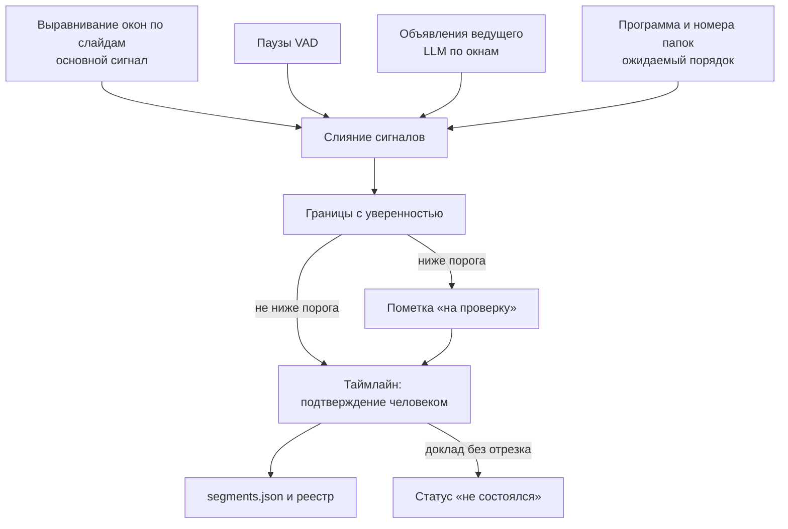
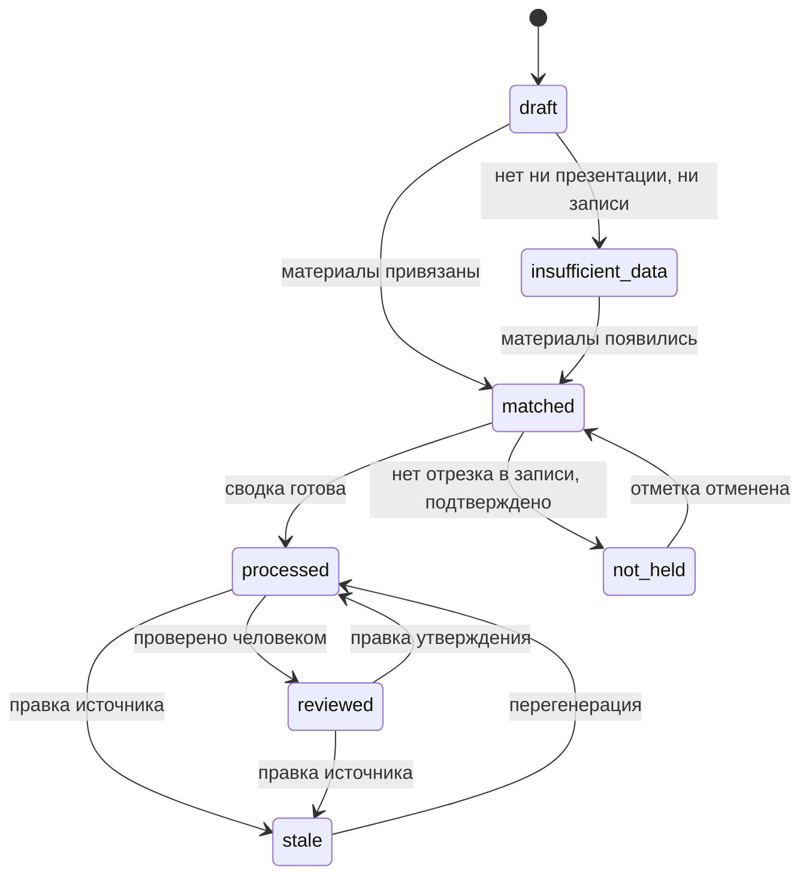
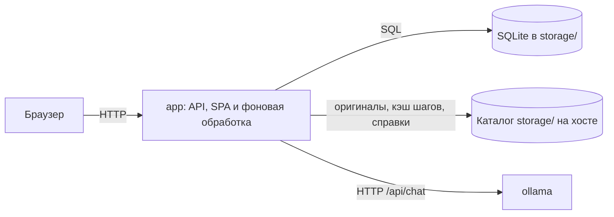

# Репортёр: спецификация генератора справок по научным конференциям

Версия 1.3 · 09.11.2026 · статус: согласована с командой 2 вместе с поправками ADR-008, ADR-009 и ADR-010; упрощения MVP — ADR-011; упрощение архитектуры — ADR-014, ждёт просмотра командой 2 · «Репортёр» (Rapporteur) — название проекта

## 0. О документе

Документ — единственный источник требований к проекту. Он сводит два исходных ТЗ, разбор их сильных и слабых сторон и ответы команды 1 на вопросы разбора.

| Источник | Что из него взято |
| --- | --- |
| `docs/SoW/technical-documentstion.md`, ТЗ команды 1, 22.10.2026 | Предметная часть: входные данные, конвейер, разбиение записей, схема фактов, бланк и склонения, модели, офлайн-поставка, метрики по этапам |
| `docs/SoW/conference-assistant-master-spec.md`, ТЗ команды 2, 27.10.2026 | Процесс: контракты до кода, фазы с критериями, режим без GPU, ревизии фрагментов, безопасность разбора файлов, пороги приёмки, бэкап |
| `docs/SoW/Совместное техническое задание.md` ([артефакт](https://claude.ai/artifact/XJDBivrGXVQRKKd5iu7EEE)), разбор двух ТЗ, редакция 2 | Решения по спорным пунктам, режимы GPU, распределение работ между командами |

Исходные ТЗ сохраняются как история и больше не обновляются. Каталог `docs/SoW/` не хранится в git, его копия есть у каждой команды.

**Как менять.** Требования меняются через PR с правкой этого файла. Архитектурное решение оформляется ADR в [adr/](adr/README.md) и вносится в спецификацию в том же PR. Изменения контрактов (§7) и ADR требуют одобрения обеих команд; пока команда 2 не подключилась, их принимает команда 1, а команда 2 просматривает при подключении (ADR-011).

**Оценки.** Объёмы памяти, токенов и сроки здесь проектные. Результаты реальных замеров записываются в `docs/benchmarks/` и заменяют оценки.

Связанные документы: [backlog.md](backlog.md) (задачи Ф0–Ф1), [adr/](adr/README.md) (решения), [CODEOWNERS](../CODEOWNERS) (владельцы каталогов).

## 1. Цель

Сотрудники организации и слушатели посещают научные конференции и по итогам готовят справку установленной формы. В справке есть краткое описание каждого доклада (4–5 предложений), его основные выводы, если они есть, и переменные параметры: название конференции, даты, место, количество докладов и докладчиков.

Приложение автоматизирует подготовку справки:

- принимает материалы конференции: презентации, аудио- и видеозаписи, текстовые заметки слушателей, при наличии программу;
- распознаёт речь и разбивает многочасовые записи на отдельные доклады;
- по каждому докладу отдельно готовит сводку и список выводов со ссылками на источники;
- даёт человеку проверить и исправить результат;
- собирает справку по бланку за выбранные дни, секции и доклады и выдаёт её в Markdown, DOCX и PDF.

Справка — официальный документ. Выдуманный факт или вывод хуже пропущенного.

### 1.1. Границы MVP

Входит:

1. Одна общая рабочая область без учётных записей: все конференции и справки видны каждому, кто открыл приложение (ADR-011).
2. Конференции с секциями и докладами; реестр из папки и ручная загрузка с привязкой файлов.
3. Форматы из §5.2: презентации, аудио, видео, текстовые заметки, программа как подсказка.
4. Распознавание речи и разбиение многочасовых записей на доклады с проверкой на таймлайне.
5. Сводка по каждому докладу с проверенными цитатами, правка и подтверждение.
6. Справка по выбранным дням, секциям и докладам; Markdown, DOCX, PDF.
7. Очередь задач с приоритетами, отменой и повтором.
8. Оценка качества на эталоне (`make eval`).
9. Офлайн-установка, резервное копирование и восстановление.

Не входит: см. §18.

## 2. Жёсткие ограничения

- **Полностью локальная работа.** Никаких внешних API, телеметрии и загрузок из интернета во время работы. Веса моделей заранее лежат во внешнем каталоге, подключённом к контейнерам, заданы `OLLAMA_NO_CLOUD=1`, `HF_HUB_OFFLINE=1` и `TRANSFORMERS_OFFLINE=1`. Фронтенд без CDN. Исходящий трафик из контейнеров во время работы закрыт.
- **Установка в изолированной сети.** Образы переносятся через `docker save` / `docker load`, веса архивом с закреплённой ревизией и контрольной суммой. Есть скрипт сборки комплекта на машине с интернетом и инструкция установки.
- **Железо.** 2× NVIDIA A100 40 ГБ (Ampere), карты связаны NVLink, оперативной памяти больше 200 ГБ. Аппаратной FP8-арифметики нет, поэтому рабочие варианты моделей — GGUF в BF16, q8_0 и q4_K_M.
- **Развёртывание.** Docker и docker compose, GPU через NVIDIA Container Toolkit. Один `compose.yaml`: приложение и Ollama (ADR-014).
- **Язык.** Доклады на русском с латинскими терминами, аббревиатурами и названиями. Интерфейс и все выходные документы на русском.
- **Пользователи.** Любой сотрудник или слушатель конференции. В MVP учётных записей нет, доступ ограничивается сетью; учётки появятся на следующем этапе (ADR-011).
- **Записи.** Стенограмм на входе нет, есть только аудио или видео. Записи сделаны телефоном из зала: дальний микрофон, шум, реверберация. Длина до нескольких часов, в одном файле часто несколько докладов.
- **Масштаб.** От одной секции на 10 докладов до пяти секций по 20 докладов, то есть до 100 докладов на конференцию.
- **Исходные файлы пользователя не изменяются.** Обработка идёт над копиями.

## 3. Принципы

Принципы меняются только через ADR.

1. **Изоляция докладов.** Один доклад — один контекст LLM. Несколько докладов в одном промпте запрещены. Запросы по разным докладам независимы и могут выполняться параллельно. Единственное исключение — поиск объявлений ведущего (§6.5): окна стенограммы сессии анализируются до того, как известны границы, и из них извлекаются только служебные сведения, а не содержание докладов.
2. **LLM возвращает данные, документ собирает код.** Модель выдаёт JSON по схеме. Справку собирает код по бланку. Числа, даты, счётчики и склонения считает только код.
3. **Реестр докладов — центральная сущность.** Все источники сначала сопоставляются с реестром и только потом идут в обработку. Папка и ручная загрузка дают один и тот же реестр.
4. **Обоснованность.** Каждое утверждение сводки опирается на цитату из источника с меткой места. Цитату в источнике находит код. Утверждение без подтверждённой цитаты в справку не попадает. Найденная цитата ещё не доказывает смысловую поддержку, поэтому есть критик и проверка человеком.
5. **Человек в контуре.** Три обязательные проверки: привязка материалов к докладам, границы докладов в записях, сводки перед выгрузкой.
6. **Идемпотентные этапы.** Результат каждого этапа сохраняется. Ключ результата: хэши входа, версия обработчика, хэш конфигурации. Перезапуск возможен с любого этапа, распознавание речи после правок не повторяется, одну и ту же запись не распознают дважды.
7. **GPU — общий ресурс.** К модели обращается только фоновая обработка приложения через Ollama, по одному докладу за раз; сборка справки модель не использует (ADR-014).
8. **Модели подключаются через профили.** Ни один компонент не привязан к конкретной модели.
9. **Бланк заменяемый.** DOCX-бланк и описание переменных меняются без правки кода.
10. **Текст источников — только данные.** Инструкции внутри презентаций, стенограмм и заметок не исполняются. У модели нет инструментов, сети и доступа к файлам.
11. **Пробелы не заполняются молча.** Если данных нет, это помечается явно.

## 4. Пользователи и сценарии

### 4.1. Роли и доступ

В MVP учётных записей и ролей нет (ADR-011). Каждый, кто открыл приложение, создаёт конференции, загружает материалы, запускает обработку, проверяет и правит результаты, собирает и выгружает справки, видит очередь задач (отмена, приоритет) и состояние системы: загрузку GPU, место на диске, возраст последнего бэкапа. Профили моделей и бланки настраиваются файлами конфигурации; модель для сводок и режим рассуждения можно выбрать на странице «Управление». Все записи принадлежат встроенному пользователю `local`.

На следующем этапе появятся учётные записи и роли:

- **Пользователь** видит и правит только свои конференции и справки.
- **Администратор** видит все конференции, управляет учётками, профилями моделей и бланками из интерфейса, видит журнал действий.

Тогда же права начнут проверяться на каждом вложенном объекте: файлах, фрагментах, сводках, задачах, выгрузках; идентификатор объекта не считается защитой. Общие конференции и соредакторы появятся позже (ADR-006). Модель данных к учёткам готова: поля владельца и автора есть в контрактах с первой версии.

### 4.2. Основной сценарий

1. Пользователь создаёт конференцию: название, даты, место, организатор. Неизвестное можно оставить пустым. Добавляет секции.
2. Загружает папку или отдельные файлы. Система строит реестр и предлагает привязку каждого файла к докладу с оценкой уверенности. Пользователь подтверждает или исправляет (проверка 1).
3. Запускает обработку и видит очередь, текущий этап и прогресс.
4. Проверяет границы докладов в длинных записях на таймлайне с плеером (проверка 2).
5. Проверяет и правит сводки. Клик по утверждению открывает слайд или запись с нужного таймкода (проверка 3).
6. Создаёт справку: выбирает дни, секции и доклады, смотрит предпросмотр, выгружает Markdown, DOCX или PDF. Если в выборке есть непроверенные доклады, система предупреждает и продолжает только после явного подтверждения.

### 4.3. Экраны

1. Список конференций.
2. Конференция: метаданные, секции, реестр докладов со статусами, запуск обработки.
3. Загрузка материалов и привязка к докладам по подсказкам.
4. Таймлайн записи с плеером: границы, переназначение отрезков, подтверждение.
5. Редактор сводки со ссылками на источники.
6. Справка: выбор докладов, предпросмотр, выгрузка.
7. Очередь задач.
8. Состояние системы: очередь, GPU, диск. Экран администрирования (учётки, профили, бланки) — на следующем этапе.

Интерфейс не блокируется во время обработки. Статусы обновляются опросом API раз в 2–5 секунд с увеличением интервала на долгих задачах; WebSocket в MVP не нужен.

## 5. Входные данные

### 5.1. Структура папки конференции

```
<Конференция>/
  _общее/              программа, записи целых сессий, общие заметки
  <Секция>/            необязательный уровень, если секций несколько
    _общее/            записи сессий секции
    <NN>_<Фамилия>/    материалы одного доклада: pptx/pdf, аудио/видео, txt
  conference.yaml      создаётся и обновляется приложением
```

Имена папок — подсказка, а не истина. Приложение справляется с отклонениями: файлы не в той папке, нет подпапок, всё в одной папке.

### 5.2. Форматы

| Тип | Форматы | Обработка |
| --- | --- | --- |
| Презентации | pptx, pdf (в том числе без текстового слоя) | текст по слайдам, заметки докладчика, рендер слайдов в PNG |
| Аудио | mp3, m4a, wav, ogg, opus, aac, flac | ffmpeg → моно 16 кГц |
| Видео | mp4, mov | извлечение звука через ffmpeg |
| Заметки | txt, md | автоопределение кодировки (UTF-8, cp1251), при сомнении выбор пользователя |
| Программа | pdf, docx, xlsx, txt | извлечение ожидаемого списка докладов |

Фото и сканы рукописных заметок в MVP не поддерживаются (§18).

### 5.3. Роли источников

- **Презентации** — основной источник фактов и основной сигнал для разбиения записей. Они есть почти у каждого доклада.
- **Стенограмма** даёт акценты, выводы, прозвучавшие в речи, и вопросы из зала. Для доклада без презентации это единственный подробный источник.
- **Заметки слушателей** попадают только в `listener_remarks` и не выдаются за выводы докладчика. В справку реплики не входят. Сами по себе заметки не дают сводки (§6.5).
- **Программа** вспомогательная: ожидаемые названия, ФИО, порядок. Расхождения с материалами (доклад сняли, порядок изменили) показываются пользователю, а не разрешаются молча. Источником утверждений программа не служит.

### 5.4. Лимиты

Стартовые значения, настраиваемые и одинаковые в прокси, API, воркерах и интерфейсе:

| Что | Лимит |
| --- | --- |
| Презентация | 200 МБ, 300 слайдов; для pptx также число элементов ZIP, распакованный объём и коэффициент сжатия |
| Аудио, видео | 10 ГБ, 10 часов на файл |
| Заметки | 5 МБ |
| Изображение слайда при рендере | 40 мегапикселей |

Проверяется фактическое декодированное содержимое, а не только метаданные файла.

## 6. Конвейер обработки

Результат каждого этапа сохраняется как артефакт JSON и может быть пересчитан отдельно. Ошибка одного файла не скрывает результаты остальных.

```mermaid
flowchart LR
  subgraph C["Вся конференция"]
    A["6.1 Приём и инвентаризация"] --> B["6.2 Разбор презентаций"]
    A --> D["6.3 Предобработка аудио"] --> E["6.4 Распознавание речи"]
    B -- "словарь терминов" --> E
    B --> F["6.5 Разбиение записей и реестр"]
    E --> F
  end
  F -- "проверки 1 и 2" --> T
  subgraph P["Каждый доклад отдельно"]
    T["6.6 Коррекция терминов"] --> G["6.7 А. Факты и цитаты"]
    G --> H["6.7 Б. Сверка цитат кодом"]
    H --> I["6.7 В. Текст сводки"]
    I --> J["6.7 Г. Проверки"]
    J -- "не прошло, до N раз" --> I
    H -- "нет цитаты" --> X["утверждение отброшено"]
    J --> K["6.8 Правка человеком, проверка 3"]
  end
  K --> L["6.9 Сборка справки"] --> M["Markdown, DOCX, PDF"]
```



### 6.1. Приём и инвентаризация

- SHA-256 каждого файла, дедупликация, тип по содержимому, а не по расширению.
- Длительность аудио и видео, кодировка текстов.
- Оригинал сохраняется в хранилище по хэшу (ADR-005) и больше не меняется.

Выход: `inventory.json`.

### 6.2. Разбор презентаций

- pptx (python-pptx): заголовки и текст по слайдам в порядке чтения, таблицы, заметки докладчика.
- pdf (pypdfium2, ADR-001): текст по страницам.
- Все слайды рендерятся в PNG: pptx через LibreOffice headless в PDF, затем в PNG. LibreOffice работает без макросов, сети и внешних ссылок.
- Слайды без текста и со схемами, графиками, таблицами-картинками обрабатывает VLM: распознаёт текст и описывает содержимое (фаза Ф4; до этого слайд помечается «нет текста»). Описание хранится отдельным фрагментом с происхождением `vlm` и меткой `V`: это текст модели, а не источника (ADR-008).
- С титульного слайда извлекаются кандидаты в название, ФИО и организацию. Слайды «Выводы», «Заключение», «Итоги» помечаются как слайды выводов. «Результаты» не помечаются: результаты — ещё не выводы докладчика (§6.7). Если плейсхолдер заголовка пуст или занят обычным текстом, заголовком слайда считается самый крупный текст на странице, которую нарисовал LibreOffice.
- Составляется словарь доклада: аббревиатуры, слова на латинице, специальные термины, ФИО. Он нужен для распознавания речи и коррекции терминов.

Выход: `slides.json` — `[{slide_no, title, text, tables, notes, image_path, vlm_description, is_conclusion}]`, титульные данные, словарь.

Приёмка: текст есть у каждого слайда или слайд явно помечен; ненайденные титульные данные помечены; битый или зашифрованный файл даёт понятную ошибку.

### 6.3. Предобработка аудио

- ffmpeg: моно, 16 кГц, нормализация громкости (loudnorm), фильтр высоких частот против гула.
- Разметка речи и тишины: Silero VAD.
- Шумоподавление — только опция профиля, по умолчанию выключено. Включается, если сравнение на эталоне покажет снижение WER.
- Многочасовые файлы обрабатываются потоком по частям, без загрузки целиком в память.

### 6.4. Распознавание речи

- Единый интерфейс ASR-движка с адаптерами под кандидатов из §9.
- Длинные записи режутся по VAD на куски около 10 минут с перекрытием по границе тишины и склеиваются по таймкодам слов без потерь и дублей. Короткие куски позволяют прерывать длинную задачу ради интерактивных.
- Таймкоды слов абсолютные, относительно исходного файла.
- Словарь доклада передаётся движку как подсказка, если движок это поддерживает.
- Если движок не ставит пунктуацию, подключается отдельная модель восстановления пунктуации.
- Защита от «галлюцинаций» на тишине и музыке: распознаются только участки речи, повторы фильтруются.
- Диаризация (pyannote) — необязательный дополнительный сигнал; на дальнем микрофоне она ненадёжна.
- Качество оценивается по фрагментам (уверенность модели, доля неразборчивого), выставляется флаг `low_quality`. Если движок не даёт уверенность, хранится `null`.

Выход: `transcript.json` — сегменты и слова с таймкодами, уверенностью и меткой говорящего.

Приёмка: WER и CER на эталоне; отдельно точность на терминах из словаря, числах и ФИО; на стыках кусков ничего не теряется; тишина не порождает текст.

### 6.5. Разбиение записей и реестр

Применяется к записям, которые охватывают несколько докладов. Сигналы по убыванию веса:

1. **Выравнивание по слайдам — основной сигнал.** Стенограмма режется на окна около 60 с с перекрытием, окна и слайды каждой презентации переводятся в эмбеддинги. По матрице сходства монотонным выравниванием (динамическое программирование) находятся точки разреза: доклады идут по порядку реестра. Окна, не похожие ни на одну презентацию, — кандидаты в служебные отрезки.
2. **Паузы.** Длинные паузы по VAD. Смена основного говорящего и детектор аплодисментов — после MVP, если замер покажет пользу.
3. **Объявления ведущего.** LLM просматривает окна стенограммы по 3–5 минут с перекрытием и возвращает JSON: таймкод, тип (`announcement`, `break`, `qa_start`, `closing`), ФИО и объявленное название, если они прозвучали. Объявления непостоянны, поэтому только уточняют границы.
4. **Программа и номера папок** задают ожидаемый порядок и служат ограничением для выравнивания.



Сигналы объединяются в границы с оценкой уверенности; порог проверки настраивается, по умолчанию 0,7. Внутри доклада размечаются основная часть и вопросы-ответы, отдельно служебные отрезки: перерывы, организационные объявления.

Особые случаи:

- **Доклад без презентации** (редко): опора на объявления, паузы и программу, уверенность низкая, граница уходит на проверку. Сводка строится по стенограмме.
- **Доклад из реестра без отрезка в записи** получает статус «не состоялся» после подтверждения пользователем и не входит в счётчики и справку.
- **Нет записи секции совсем:** решение за пользователем. Правило предварительное, см. §19.
- Презентация без записи и запись без презентации обрабатываются как отдельные случаи с явной пометкой.
- **Нет ни презентации, ни записи:** сводка не строится, даже если есть заметки. Доклад с известным названием получает статус «Недостаточно информации» и не входит в счётчики и справку, пока не появятся материалы. Без названия доклад не заводится, а файлы остаются непривязанными (ADR-008).

Пользователь проверяет границы на таймлайне с прослушиванием: сдвигает их, переназначает отрезки, подтверждает. Правка границ не запускает распознавание заново.

Выход: `segments.json` и обновлённый реестр.

Приёмка: на размеченном эталоне медиана отклонения границ не больше 30 с, граница с отклонением больше 2 минут считается ошибкой, считается доля верно отнесённых минут. Цели уточняются после первого замера.

### 6.6. Коррекция терминов

LLM исправляет в стенограмме доклада искажённые термины, ФИО и аббревиатуры по словарю из слайдов и программы.

- Меняются только термины, ничего не перефразируется.
- Код принимает замену, только если новое слово есть в словаре доклада и похоже на исходное по написанию или звучанию. Остальные замены отбрасываются.
- Таймкоды сохраняются.
- Хранятся исходный и исправленный текст, разница видна пользователю.

### 6.7. Сводка по докладу

**Вход.** Метаданные доклада и пакет фрагментов этого доклада с метками мест (ADR-003, ADR-008): `S12` — слайд 12 (при нескольких презентациях `S2.12`), `T00:12:34` — отрезок стенограммы (при нескольких записях `T2.00:12:34`), `N3` — заметка 3, `V12` — описание слайда от VLM. Метки назначаются при сборке пакета. Вопросы-ответы идут отдельным блоком.

**Бюджет контекста.** Начальная длина контекста 32K токенов, резерв на рассуждение и ответ не меньше 8K. Доклад на 40 минут даёт порядка 10–15 тыс. токенов стенограммы, поэтому обычно помещается целиком. Бюджет считается токенизатором выбранной модели. При переполнении материалы делятся по границам слайдов, факты извлекаются по частям и объединяются с удалением дублей, текст пишется из объединённых фактов. Все части относятся к одному докладу.

**Шаг А — извлечение фактов.** Режим рассуждения включён, температура низкая, вывод строго по JSON Schema (`format` в `/api/chat`). Грамматика проверяет только форму ответа, поэтому связи между полями проверяет модель `FactsDraft`, а невалидный ответ уходит на повтор. Ответ, оборванный лимитом токенов, считается ошибкой. Если на базовой модели рассуждение и схема не уживаются или рассуждение съедает лимит, используются два вызова: рассуждение текстом, затем JSON.

```json
{
  "title": "...",
  "speakers": ["..."],
  "affiliations": ["..."],
  "talk_type": "исследовательский | обзорный | прикладной | иное",
  "problem": {"text": "...", "evidence": [{"label": "S2", "quote": "..."}]},
  "methods": [{"text": "...", "evidence": []}],
  "results": [{"text": "...", "evidence": []}],
  "conclusions": [{"text": "...", "evidence": []}],
  "conclusions_absent_reason": null,
  "listener_remarks": [{"text": "...", "evidence": [{"label": "N3", "quote": "..."}]}],
  "uncertain": ["..."]
}
```

Правила для модели:

- Числа, термины и названия — только из источников.
- При расхождении слайдов и стенограммы числа берутся со слайдов.
- Если стенограмма помечена `low_quality`, факты берутся со слайдов, а стенограмма даёт акценты.
- Выводы — только явно сформулированные докладчиком: на слайде выводов или прямо в речи. Если таких нет, список пуст и указана причина, например «обзорный доклад».
- Мнения из заметок слушателей идут в `listener_remarks` и не выдаются за выводы докладчика.

Поля `title`, `speakers` и `affiliations` — подсказка для сверки с реестром. В справку эти сведения идут только из реестра, расхождение показывается пользователю (ADR-008).

**Шаг Б — сверка цитат кодом.** Каждая цитата ищется в источнике с указанной меткой нечётким сравнением (rapidfuzz) по поисковой форме текста: регистр, ё и е, пунктуация, пробелы, кавычки и тире приведены к одному виду. Порог настраивается. Токены с цифрами и отрицания `не`, `ни` должны совпасть точно, цитата короче минимальной длины отклоняется: нечёткое сравнение само по себе пропускает подмену числа (ADR-008). Код вычисляет ревизию фрагмента и диапазон символов (ADR-003). Утверждение без подтверждённой цитаты не попадает в сводку или уходит на перегенерацию.

**Шаг В — текст сводки.** Из проверенных фактов пишется 4–5 предложений в научно-деловом стиле, в третьем лице, без оценочных эпитетов. Выводы — отдельным блоком из 1–3 пунктов; если их нет, блок опускается. Каждое предложение и вывод приходят со списком `claim_ids`: код принимает их, только если список не пуст и все утверждения прошли сверку (ADR-008). Стиль уточняется по образцам справок через few-shot примеры в промпте.

**Шаг Г — проверки.**

- Код проверяет число предложений (razdel, диапазон настраивается; нижняя граница не выше числа утверждений, прошедших сверку, иначе модели пришлось бы досочинять), наличие каждого числа из сводки в источниках, отсутствие запрещённых формулировок из конфига.
- Модель-критик (тот же или другой профиль) сверяет каждое предложение сводки с фактами и источниками и возвращает список проблем.
- Если сводка не прошла проверки, она перегенерируется до N раз, затем получает статус `needs_attention` («требует внимания человека»).

Выход: `summary.json` — версия, профиль, версии промптов, ревизии входных фрагментов, результаты всех проверок.

### 6.8. Проверка и правка человеком

- В редакторе каждое утверждение и каждое предложение сводки кликабельны и ведут к источнику: картинке слайда или фрагменту стенограммы с воспроизведением с нужного таймкода.
- Все правки версионируются. Правка текста утверждения снимает с него подтверждение и возвращает доклад из `reviewed` в `processed`.
- Статусы доклада — §7.2. Новая ревизия источника не меняет уже сделанную сводку: сводка помечается «устарел», и система предлагает пересоздать её.

### 6.9. Сборка справки

**Выборка.** Справка охватывает выбранные пользователем дни, секции и доклады конференции (ADR-006). День доклада — его дата, а если она не задана, дата секции. Счётчики считаются по выборке; доклады со статусами «не состоялся» и «Недостаточно информации» в неё не входят. Доклад без готовой сводки в справку не попадает, и система об этом сообщает.

**Переменные** берутся из трёх мест:

- метаданные конференции: название, даты, место, организатор вводит пользователь, система предлагает значения из программы;
- реестр: название, докладчики и организации; количество докладов и докладчиков, список секций считает код;
- сводки: тексты и выводы.

«Количество докладчиков» по умолчанию — число уникальных выступавших в выборке без соавторов; режим настраивается.

**Бланк** — каталог в `templates/` с DOCX на Jinja-плейсхолдерах (docxtpl) и `variables.yaml`: для каждой переменной источник, тип (`str`, `int`, `period`, `list`), обязательность и описание. Код отклоняет бланк, который использует неописанную переменную, и сборку без обязательной; опечатка в бланке — ошибка, а не пропавший текст. Фильтры бланка: `период`, `согласовать`, `ёлочки`, `типографика` ([templates/README.md](../templates/README.md)). Стартовый бланк `templates/starter`, основной текст:

```
Конференция проходила {{ period | период }}
Место проведения: {{ place }}.
В рамках конференции {{ talks_count | согласовать("доклад", глагол="заслушан") }},
с докладами {{ speakers_count | согласовать("докладчик", глагол="выступил") }}.


{{ loop.index }}. {{ talk.title | ёлочки }} ({{ talk.speakers | join(", ") }})
{{ talk.summary | типографика }}
Основные выводы:
– {{ conclusion | типографика }}


```

```yaml
version: starter-1
document: report.docx
variables:
  title:          {source: conference.title, type: str, required: true}
  period:         {source: report.period, type: period, required: true}
  place:          {source: conference.place, type: str, required: false}
  organizer:      {source: conference.organizer, type: str, required: false}
  talks_count:    {source: computed.talks_count, type: int, required: true}
  speakers_count: {source: computed.speakers_count, type: int, required: true}
  talks:          {source: report.talks, type: list, required: true}
```

Имена переменных совпадают с `ReportInput` и `ReportVariables` из `rapporteur.contracts`; `period` строится из `period_start` и `period_end`.

Когда появятся реальные образцы справок, меняются DOCX, YAML и few-shot примеры стиля; код не меняется. Код придётся трогать, только если в бланке появится сведение, которого нет в данных: тогда добавляется поле в реестр или в схему фактов.

**Русская грамматика.**

- Согласуется вся фраза с числом, включая глагол: «заслушан 1 доклад», «заслушано 3 доклада», «заслушан 21 доклад», «заслушано 25 докладов» (pymorphy3).
- Даты: «22 октября 2026 г.», диапазоны «20–22 октября 2026 г.» и «30 октября – 1 ноября 2026 г.».
- Названия в кавычках-«ёлочках», неразрывные пробелы перед «г.» и между числом и единицей.
- Названия городов и организаций автоматически не склоняются: они вводятся в нужной форме, либо бланк формулируется без склонения («Место проведения: г. Казань»).

**Выдача.** Markdown в интерфейсе с кнопкой копирования; DOCX; PDF, сконвертированный из DOCX через LibreOffice headless, чтобы оформление совпадало. Отдельный файл с цитатами не выдаётся: источники видны в редакторе.

Приёмка: модульные тесты фильтров на числах 1, 2, 5, 11, 21, 22, 25, 111 и на периодах внутри месяца, через месяц и через год; тест рендера бланка со сравнением с образцовым файлом.

## 7. Модель данных

### 7.1. Сущности

Общие правила: идентификаторы UUID, время в UTC, внешние ключи и ограничения целостности; база — SQLite (ADR-014). Версии есть у сводок и справок; правка сводки передаёт номер версии, которую видел человек, и конфликт показывается пользователю.

| Сущность | Ключевые поля |
| --- | --- |
| Пользователь | в MVP один встроенный пользователь `local` (ADR-011); на следующем этапе логин, имя, роль (`user`, `admin`), активен, пароль argon2 |
| Конференция | название, даты, место, организатор, владелец, версия; общие материалы и результаты обработки |
| Участник конференции | конференция, пользователь, роль (`owner`, `editor`, `viewer`); появляется на следующем этапе вместе с учётками |
| Секция | конференция, название, дата по умолчанию для докладов, зал, порядок |
| Доклад | секция, порядковый номер, название, дата (если отличается от даты секции), тип, статус, уверенность сопоставления, версия |
| Персона | ФИО, организация; роль в докладе: докладчик или соавтор |
| Исходный файл | конференция, SHA-256, исходное имя, тип по содержимому, размер, длительность, кодировка; оригинал на томе общий по SHA-256 |
| Привязка файла | файл, доклад или конференция целиком, подтверждена ли |
| Сегмент | файл, начало и конец в мс, доклад, тип (`talk`, `qa`, `service`), уверенность, подтверждён ли |
| Фрагмент | исходный файл, вид (`slide`, `transcript`, `note`, `program`, `slide_description`), локатор |
| Ревизия фрагмента | фрагмент, номер, сырой и нормализованный текст, происхождение (`extracted`, `asr`, `vlm`, `term_fix`, `human`), автор правки, время; неизменяема |
| Утверждение | сводка, тип (проблема, метод, результат, вывод, реплика слушателя), текст, статус проверки |
| Ссылка на источник | утверждение, ревизия фрагмента, диапазон символов, цитата, оценка совпадения |
| Сводка | доклад, версия, профиль, версии промптов, предложения и выводы со ссылками на утверждения, факты, результаты проверок, автор правки, статус |
| Справка | автор, конференция, выбранные дни, секции и доклады, версия бланка |
| Версия справки | справка, снимок входных данных и версий, файлы выдачи |
| Бланк | версия, DOCX, YAML переменных |
| Профиль модели | движок, модель, ревизия весов, квантизация, параметры генерации, версия промпта, этапы |
| Задача | тип, этап, ресурс, статус, приоритет, попытка, lease, heartbeat, прогресс, код ошибки |
| Кэш этапа | ключ, этап, версия обработчика, путь к артефакту |
| Журнал действий | кто, действие, объект, когда, correlation_id; появляется на следующем этапе вместе с учётками |

### 7.2. Статусы

Доклад (в коде `draft`, `matched`, `processed`, `reviewed`, `stale`, `not_held`, `insufficient_data`):



Сводка: `ready`, `needs_attention`, `stale`. Статус «требует внимания» относится к сводке: доклад при этом остаётся `processed`.

Задача: `queued → running → succeeded | failed | cancelled`, дополнительно `retry_wait` и `cancel_requested` (ADR-004). Ожидание проверки человеком не является статусом задачи: следующая задача просто не создаётся (ADR-009). Проценты показываются только при измеримом объёме работы, иначе текущий этап.

### 7.3. Ссылки на источник

Модель указывает метку и цитату; всё остальное вычисляет код (ADR-003):

```json
{
  "label": "T00:12:34",
  "quote": "точность выросла до 94 %",
  "fragment_revision_id": "…",
  "span": [118, 142],
  "match_score": 0.97
}
```

- `label` и `quote` даёт модель; `fragment_revision_id`, `span` и `match_score` вычисляет код.
- Диапазоны полуоткрытые `[start, end)`, в кодовых точках Unicode нормализованного текста ревизии. Фронтенд не путает их со смещениями UTF-16 в JavaScript.
- Нормализованный текст — отображаемый: регистр, пунктуация, числа и ё сохранены. Поисковая форма не хранится, она строится на время сверки вместе с картой смещений (ADR-008).
- Номер слайда, таймкод и путь к файлу сервер берёт из локатора фрагмента. Модель не формирует URL, имена файлов и номера страниц.
- Метки живут в пакете фрагментов одного доклада (`TalkFragmentPack`). Цитата из другого доклада не находится, потому что её фрагмента нет в пакете. Фрагмент стенограммы входит в пакет, если его середина лежит внутри подтверждённого сегмента доклада.
- Правила, связывающие несколько объектов, JSON Schema не выражает: их проверяют валидаторы моделей `rapporteur.contracts` (например, `TalkSummaryBundle`) перед записью сводки.

### 7.4. Реестр в файле

Реестр хранится в БД и экспортируется в `conference.yaml`, чтобы его можно было прочитать и поправить вручную:

```yaml
conference:
  title: "Название конференции"
  dates: ["2026-10-20", "2026-10-22"]
  place: "г. Казань"
sections:
  - id: s1
    title: "Секция 1"
    date: "2026-10-20"
talks:
  - id: t01
    section: s1
    order: 1
    date: "2026-10-20"
    title: "Название доклада"
    speakers: ["Иванов И. И."]
    coauthors: ["Петрова А. А."]
    affiliations: ["Название организации"]
    sources:
      slides: ["s1/01_Иванов/доклад.pptx"]
      audio:
        - file: "s1/_общее/сессия_1.m4a"
          start: "00:03:00"
          end: "00:35:30"
      notes: ["s1/01_Иванов/заметки.txt"]
    status: matched
    confidence: 0.92
```

## 8. Архитектура и развёртывание

### 8.1. Сервисы

Один `compose.yaml` в корне репозитория (ADR-014).

| Сервис | Назначение |
| --- | --- |
| `app` | FastAPI (Python 3.12), собранный фронтенд как статика и фоновая обработка докладов в одном процессе; база SQLite и файлы — в каталоге хранилища на хосте (`storage/`, в контейнере `/data`); слушает адрес из конфигурации, по умолчанию только внутренний |
| `ollama` | LLM и VLM с HTTP API и structured outputs; модели лежат во внешнем каталоге, подключённом через `volumes`; модель выбирается именем в запросе (ADR-010). Вместо своей можно подключить Ollama другого проекта: сервис `app-shared` ([ollama.md](ollama.md)) |
| `proxy` | nginx, если нужен TLS или единая точка входа; решается при установке |



### 8.2. Компоненты

- **Обработка** — фоновый поток приложения (`rapporteur/processing.py`). Доклад ставится в очередь полем `talks.job`. Это происходит при запуске обработки, при подтверждении привязок после запуска и при повторе. Поток берёт доклады по одному и проходит цепочку §6: разбор → пакет → факты → сверка → сводка. После перезапуска прерванные доклады обрабатываются заново (ADR-014).
- **База** — SQLite (`storage/rapporteur.db`, в контейнере `/data/rapporteur.db`, режим WAL). Схема создаётся при старте приложения. Конвейерные функции (`ingest/`, `summarize/`, `report/`) от БД не зависят.
- **Хранилище** — каталог на хосте (`RAPPORTEUR_STORAGE`, по умолчанию `storage/`), подключённый в контейнер как `/data`: оригиналы по SHA-256, кэш шагов `cache/<шаг>/<ключ>.json`, картинки слайдов, файлы справок (ADR-005). Ключ кэша — хэш версии шага, входа и конфигурации.
- **GPU** — запросы к модели идут через Ollama по одному докладу за раз. Режим работы двух карт выбирается замером (ADR-002). Доступа к Docker socket ни у одного контейнера нет.
- **LLM** вызывается только через внутренний клиент-абстракцию поверх `/api/chat` Ollama: там доступны `think`, `format`, `keep_alive` и `num_ctx`. Браузер к LLM не обращается.
- **Фронтенд** — React, TypeScript, Vite; таймлайн на wavesurfer.js. Все ресурсы собраны в образ.
- **Конфигурация** — переменные окружения, `profiles.yaml`, `prompts/`, `templates/`. Секретов в репозитории нет, есть `.env.example`.
- **Логи** структурированные и только локальные. Тексты материалов, аудио, промпты и ответы модели в обычные логи не пишутся.
- **Проверки**: линтеры, проверка типов и тесты запускаются в контейнерах командой `make check`. Перед слиянием в `main` автор запускает её и пишет результат в описании PR. GPU-тесты помечены отдельно и в `make check` не входят. CI появится на следующем этапе (ADR-011).

### 8.3. Офлайн-поставка

Комплект собирает `make bundle` ([docs/offline.md](offline.md)): образы через `docker save`, выбранные модели в формате каталога Ollama и `SHA256SUMS`; на целевой машине — `make install` и `make start`. Целевое состояние: скрипт на машине с интернетом скачивает модели в каталог Ollama (`manifests/` и `blobs/` с адресацией по SHA-256) и остальные веса с закреплёнными ревизиями и контрольными суммами, собирает образы, выполняет `docker save` и упаковывает комплект. В изолированной сети каталог подключается к контейнеру через `volumes`, сетевых обращений `ollama pull` там нет. Инструкция описывает установку и проверку контрольных сумм. Используются только закреплённые версии и digest образов, тег `latest` запрещён.

### 8.4. Репозиторий

```
rapporteur/
├─ src/rapporteur/   пакет приложения (ADR-014)
│  ├─ contracts/     Pydantic-модели сущностей, фрагментов, утверждений, сводок, справки
│  ├─ ingest/        инвентаризация, pptx и pdf, рендер слайдов, заметки, ffprobe
│  ├─ summarize/     пакет фрагментов, факты, сверка цитат, текст, проверки
│  ├─ report/        переменные, склонения, бланк, выдача MD, DOCX, PDF
│  ├─ llm/           клиент Ollama, профили, промпты, структурированные ответы
│  ├─ app.py         HTTP API и статика
│  ├─ db.py          схема SQLite
│  ├─ materials.py   реестр, подсказки и подтверждение привязок
│  ├─ processing.py  фоновая обработка докладов
│  ├─ summaries.py   правка и проверка сводок
│  └─ reports.py     сборка справки и её версии
├─ tests/            тесты и фикстуры
├─ frontend/         React + Vite + TypeScript
├─ prompts/          промпты с версиями
├─ templates/        DOCX-бланки и YAML переменных
├─ profiles.yaml     профили моделей
├─ docs/             spec.md, backlog.md, adr/, benchmarks/, api.md, licenses.md
├─ Dockerfile, compose.yaml, Makefile, pyproject.toml, uv.lock
```

Конвейерные функции не зависят от веба и БД: принимают данные и возвращают результат. Каталоги `speech/` и `segment/` в `src/rapporteur/` и `eval/` в корне появятся вместе с кодом Ф2–Ф3 и `make eval`.

## 9. Модели и профили

Список — отправная точка. Перед включением в комплект проверяются актуальные версии и лицензии; выбор делается по сравнению на эталоне (§12, ADR-002).

| Задача | Кандидаты | Примечание |
| --- | --- | --- |
| LLM, базовый | `qwen3.6:27b-bf16` | на двух картах, мультимодальная, может служить VLM |
| LLM, быстрый | `qwen3.6:35b-a3b-bf16` | MoE; для поиска объявлений по многочасовым стенограммам и коррекции терминов |
| LLM, на качество | MoE класса ~120B-A10B в 4 битах, например Qwen3.5-122B-A10B | версию и лицензию проверить |
| LLM, альтернативы | Gemma 4 31B, открытые модели GigaChat | сравнить на эталоне |
| VLM для слайдов | та же мультимодальная LLM или отдельная модель | |
| Распознавание речи | GigaAM-v3, Whisper large-v3, Qwen3-ASR + Qwen3-ForcedAligner | в части вариантов GigaAM словарь только кириллический |
| VAD | Silero VAD | |
| Диаризация | pyannote | необязательный сигнал; модели скачиваются после принятия условий |
| Эмбеддинги | BGE-M3, multilingual-e5-large | для выравнивания по слайдам |
| Пунктуация | для движков, которые её не ставят | |
| Шумоподавление | DeepFilterNet | только эксперимент |

Оценка памяти по размеру весов (замер в Ф0):

| Кандидат | Веса | Где работает |
| --- | --- | --- |
| `qwen3.6:27b-bf16` | 56 ГБ | обе карты |
| `qwen3.6:35b-a3b-bf16` | 72 ГБ | обе карты, KV-кэша мало |
| MoE ~120B-A10B, 4 бита | ≈ 65–70 ГБ | обе карты, KV-кэша мало |
| MoE 200B+, 4 бита | ≈ 120–130 ГБ | только с экспертами в RAM (llama.cpp, ktransformers); эксперимент, скорость упирается в CPU |

Оперативная память не расширяет видеопамять. Она держит веса в файловом кэше ОС, поэтому повторная загрузка модели быстрее холодной. Модель переключается именем в запросе, Ollama сам выгружает простаивающую; время смены замеряется в P0-03.

**Профиль** — движок, модель, ревизия весов, квантизация, параметры генерации (температура, режим рассуждения, максимальная длина) и версия промпта. Профиль назначается на этап: быстрая модель может искать объявления, сильная — писать факты и сводки. Разрешённые профили и профиль по умолчанию задаются файлом конфигурации, пользователь выбирает из разрешённых. На следующем этапе ими управляет администратор из интерфейса (ADR-011).

**Квантизация.** Точность важнее скорости: по умолчанию BF16 без квантизации. Квантованные варианты (`q8_0`, `q4_K_M`) — альтернативные профили для сравнения.

**Лицензии** всех моделей и библиотек фиксируются в `docs/licenses.md` до включения в комплект. `trust_remote_code` включается только после проверки конкретного кода.

## 10. Безопасность

В MVP учётных записей нет, поэтому защита опирается на сеть (ADR-011). Любой, у кого есть сетевой доступ к `web`, видит все материалы; это осознанный риск MVP.

1. `app` слушает только внутренний адрес сервера. Ollama недоступна из пользовательской сети, база — файл в хранилище приложения.
2. Пользовательский текст экранируется; HTML из ответа модели не вставляется в страницу.
3. Тип файла определяется по содержимому, ключи хранения генерирует сервер, имена файлов — только отображаемые метаданные. Защита от path traversal, zip-бомб и бомб распаковки (§5.4).
4. Парсеры и конвертеры работают без root, с лимитами CPU, памяти и времени, без сети и без доступа к Docker socket. Макросы и внешние ссылки в документах отключены.
5. Текст источников — данные: команды и «системные сообщения» внутри материалов не меняют поведение системы.
6. Отладочные артефакты с содержимым доступны ограниченно и удаляются по сроку.
7. Удаление материала удаляет производные данные и помечает зависимые сводки и справки устаревшими; интерфейс заранее показывает последствия.
8. На следующем этапе, вместе с учётками: пароли argon2 и ограничение попыток входа, cookies Secure и HttpOnly, CSRF-защита, проверка прав на каждом вложенном объекте (§4.1).

Антивирусная проверка загрузок и TLS внутри контура — после пилота или по требованию сети установки.

## 11. API

- JSON, OpenAPI из FastAPI, префикс `/api/v1`.
- Ошибка — `{"message": ...}` с кодом 404, 409 для конфликта версии сводки или пути файла, 413 для размера, 415 для типа, 422 для входных данных; 401 и 403 появятся вместе с учётками (ADR-014).
- Правка и подтверждение сводки передают номер версии в теле запроса. Справка собирается в запросе и сразу возвращает версию.
- Повтор той же операции с тем же входом возвращает существующий результат: шаги кэшируются по ключу, загрузки дедуплицируются по хэшу.
- Группы ресурсов: конференции; материалы и привязки; доклады; ход обработки и повтор; сводки, версии и подтверждение; справки и выгрузки; состояние системы. Сегменты, фрагменты и ревизии появятся вместе с записями (Ф2–Ф3). Вход, текущий пользователь и администрирование — на следующем этапе.

Полный список маршрутов ведётся в `docs/api.md`.

## 12. Оценка качества

Система оценки создаётся в первой фазе, до основной функциональности.

**Эталон** лежит вне git, в репозитории только `eval/manifest.yaml` с контрольными суммами и правилами нормализации:

- реальные записи с телефона из зала;
- ручные расшифровки 30–60 минут этих записей;
- разметка границ докладов в длинных записях;
- эталонные сводки и разметка ключевых фактов по докладам;
- отложенная часть набора только для итоговой приёмки; промпты на ней не настраиваются.

Пока реальных данных нет, используется синтетический мини-набор: презентации, сгенерированные python-pptx, тексты заметок и «сессия» из склеенных русскоязычных записей с подходящей лицензией.

| Этап | Метрика | Цель MVP |
| --- | --- | --- |
| Распознавание речи | WER, CER; точность на терминах, числах и ФИО отдельно | фиксируется после первого замера |
| Разбиение записей | отклонение границ (медиана, максимум), доля верно отнесённых минут | медиана ≤ 30 с, отклонение > 2 мин — ошибка |
| Сопоставление материалов | доля верных привязок | фиксируется после первого замера |
| Ссылки | доля опубликованных утверждений с подтверждённой цитатой | 100% |
| Смысловая поддержка | доля утверждений, подтверждённых по ручной оценке | ≥ 95% |
| Выдумки | выдуманные имена, числа, результаты, атрибуции | 0; дефект блокирует выпуск |
| Полнота | доля размеченных ключевых фактов в сводке | ≥ 90% |
| Структура | ответы, прошедшие схему | 100%; невалидный ответ — контролируемая ошибка |
| Стиль и длина | соблюдение диапазона предложений, ручная оценка стиля | по образцам справок |
| DOCX | открывается без восстановления, кириллица, стили | 100% |

Инструменты:

- `make eval` прогоняет профили на эталоне и выдаёт отчёт с таблицей метрик.
- Изменение промпта или модели не принимается, если метрики на эталоне ухудшились сильнее порога из конфига.
- Ручные оценки сохраняются и попадают в отчёт.
- Заглушки моделей нужны для разработки и автоматических тестов, но не доказывают качество.

Производительность — ориентиры до замеров: p95 обычных запросов API < 500 мс; конференция на 100 докладов обрабатывается в пределах ночи. Реальные цели фиксируются после P0-03 и P1-10.

## 13. Эксплуатация

- **Страница состояния**: загрузка и память GPU, место на диске, глубина и возраст очереди, зависшие задачи, возраст последнего бэкапа.
- **Резервное копирование**: ежедневно копия каталога хранилища (база SQLite и файлы) на отдельное хранилище. Цели пилота RPO ≤ 24 ч, RTO ≤ 4 ч; восстановление проверяется на чистой машине.
- **Сроки хранения** (согласовать с организацией до работы с реальными данными): временные файлы 24 ч, обычные логи 30 дней, бэкапы 30 дней, материалы до удаления владельцем.
- **Runbooks**: установка, обновление, откат, диагностика, удаление данных.
- Веса моделей хранятся как артефакты с точной ревизией и контрольной суммой; конфигурации, промпты и бланки — в git.

## 14. Команды и зоны ответственности

Команда 1 ведёт проект и отвечает за интеллектуальное ядро. Команда 2 (авторы второго исходного ТЗ) строит платформу. Распределение внутри команды 1 предварительное.

Команда 2 подключится позже (ADR-011). До этого все задачи, в том числе из потоков команды 2, ведёт команда 1; при подключении задача передаётся вместе со статусом и кодом. Таблица показывает постоянных владельцев потоков.

| Поток | Что входит | Ведёт | Ревью | Каталоги |
| --- | --- | --- | --- | --- |
| Архитектура | контракты, порядок обработки, ADR, бэклог, приёмка фаз, интеграция | К1 · лид | К2 | `src/rapporteur/contracts/`, `src/rapporteur/processing.py`, `docs/` |
| Оценка качества | эталон и разметка, `make eval`, сравнение моделей и ASR | К1 · лид | К2 · A | `eval/` |
| Разбиение записей | выравнивание по слайдам, слияние сигналов, несостоявшиеся доклады | К1 · лид | К2 · A | `src/rapporteur/segment/` |
| Сводки | коррекция терминов, поиск объявлений, факты, сверка цитат, текст, проверки, промпты | К1 · разработчик | К1 · лид | `src/rapporteur/summarize/`, `src/rapporteur/llm/`, `prompts/` |
| Сборка справки | бланк, переменные, склонения, выдача | К1 · разработчик | К2 · B | `src/rapporteur/report/`, `templates/` |
| Инфраструктура и GPU | compose, образ, Ollama, офлайн-комплект, бэкап | К2 · A | К1 · лид | `Dockerfile`, `compose.yaml`, `Makefile` |
| Приём файлов и речь | pptx и pdf, рендер, ffmpeg, VAD, адаптеры ASR | К2 · A | К1 · лид | `src/rapporteur/ingest/`, `src/rapporteur/speech/` |
| Веб-приложение | БД, API, экраны, таймлайн, редактор | К2 · B | К1 · разработчик | `src/rapporteur/{app,db,materials,summaries,reports}.py`, `frontend/` |

Правила взаимодействия (ADR-007):

- Граница между командами проходит по модулю `rapporteur.contracts` и функциям конвейера (`ingest/`, `summarize/`, `report/`): платформа вызывает их, не зная, что у них внутри (ADR-007, ADR-014).
- Контракт меняется только через PR с одобрением обеих команд. До подключения команды 2 его принимает команда 1 и записывает в список [«Ждёт просмотра командой 2»](backlog.md#ждёт-просмотра-командой-2) (ADR-011). [CODEOWNERS](../CODEOWNERS) пока служит картой владельцев; автоматическое назначение ревьюеров включается вместе с CI.
- Общие фикстуры лежат в `tests/`, модель в тестах заменяет `ScriptedClient`: интерфейс и обработка проверяются без GPU.
- Синхронизация раз в неделю на 30 минут, показ рабочего сценария в конце каждой фазы.

## 15. Фазы

Оценка в 12 недель до пилота рассчитана на четырёх участников при регулярной работе. Пока работает только команда 1, срок уточняется по итогам Ф1. Задачи Ф0–Ф1 — в [backlog.md](backlog.md); задачи следующих фаз расписываются к концу Ф1.

| Фаза | Недели | Результат | Готово, когда |
| --- | --- | --- | --- |
| Ф0 | 1 | Замеры и контракты | замеры записаны, контракты v0 согласованы обеими командами, эталон собран |
| Ф1 | 2–3 | Справка из слайдов и заметок | из папки со слайдами и заметками получается справка по бланку, каждое утверждение ведёт к слайду, `make check` проходит на заглушках, ADR-002 принят |
| Ф2 | 4–5 | Аудио одного доклада | запись «один файл, один доклад» входит в сводку, на стыках кусков ничего не теряется, тишина не даёт текста, WER по движкам в отчёте |
| Ф3 | 6–8 | Сессия на доклады | медиана отклонения границ ≤ 30 с, ошибки > 2 мин подсвечены, несостоявшиеся доклады помечены, правка границ не запускает распознавание заново |
| Ф4 | 9–10 | Качество и масштаб | VLM для слайдов, критик, стиль по образцам; ноль выдумок на отложенной части эталона; конференция на 100 докладов обработана, время записано |
| Ф5 | 11–12 | Пилот | несколько сотрудников прошли реальную конференцию от папки до утверждённой справки; восстановление из бэкапа проверено на чистой машине |

Каждая фаза завершается показом и отчётом в `docs/progress.md`: что сделано, как проверить, метрики, заглушки, риски.

## 16. Что запрещено

- Внешние сетевые обращения во время работы, кроме обмена между своими контейнерами; CDN во фронтенде.
- Генерация справки целиком моделью; вычисление чисел и дат моделью.
- Несколько докладов в одном промпте (исключение — §3, п. 1).
- Молчаливое заполнение пробелов.
- Выводы, которых докладчик не формулировал.
- Жёсткая привязка к конкретной модели или бланку.
- Изменение или удаление исходных файлов пользователя.
- Шумоподавление по умолчанию без подтверждения экспериментом.
- Исполнение инструкций из загруженных материалов и ответов модели.
- Доступ контейнеров к Docker socket; запуск парсеров от root.
- Реальные материалы конференций, веса и секреты в git.

## 17. Правила работы исполнителей

Правила одинаковы для людей и AI-ассистентов.

1. Перед работой прочитать эту спецификацию, относящиеся к задаче ADR и [backlog.md](backlog.md). Брать задачу с выполненными зависимостями и до начала назвать её критерий готовности.
2. Решения, которых нет в спецификации, принимать самостоятельно, если они обратимы, и фиксировать в ADR. Если требование неясно или противоречит ограничению, не угадывать молча: записать допущение и сообщить о нём.
3. Сначала контракт данных и поведение ошибок, затем один вертикальный сценарий. Небольшие проверяемые PR, без огромных диффов и несвязанного рефакторинга.
4. Код покрывается тестами. Для LLM и ASR используются заглушки; GPU-тесты помечены отдельно. Перед слиянием в `main` запускается `make check`, результат пишется в описании PR. Непроверенное остаётся непроверенным и так и называется в отчёте.
5. Промпты хранятся в версионируемых файлах в `prompts/`, а не в коде.
6. Режим заглушек всегда явно обозначен; заглушка не подменяет рабочую интеграцию незаметно.
7. Перед интеграцией стороннего инструмента проверить документацию именно закреплённой версии и лицензию. Не выдумывать параметры, маршруты, результаты замеров и возможности моделей.
8. В конце задачи — короткий отчёт: что сделано, как запустить и проверить, реальные результаты проверок, ограничения, следующий шаг.
9. Приоритет — точность и достоверность результата, а не скорость обработки.

## 18. Вне MVP

**Следующий этап после MVP** (ADR-011): учётные записи и роли, проверка прав на вложенных объектах, журнал действий, экран администрирования, CI с правилом защиты ветки и реальными логинами в CODEOWNERS.

Позже:

- Сравнение профилей моделей в интерфейсе со статистикой предпочтений; до этого сравнение идёт через `make eval`.
- Общие конференции: несколько сотрудников работают с одними материалами и копируют друг у друга доклады со сводками.
- Правка промптов и бланков через интерфейс; до этого они лежат в git с версиями.
- Сравнение кадров видео со слайдами как сигнал для границ, если в записи виден экран.
- Диаризация и детектор аплодисментов как обязательные сигналы.
- OCR фото и рукописных заметок.
- Вход через корпоративный каталог (LDAP или OIDC).
- MinIO, Redis и Celery, Prometheus и Grafana — при росте нагрузки.
- Мобильное приложение, Kubernetes, отдельная векторная БД, обучение моделей.

## 19. Открытые вопросы и временные решения

| Вопрос | Временное решение | Кто закрывает |
| --- | --- | --- |
| Реальные образцы справок и бланк | стартовый бланк из §6.9 | К1 · лид |
| Полный перечень переменных | предварительный (§6.9), уточняется вместе с бланком | К1 · разработчик |
| Стиль сводок | нейтральный научно-деловой, затем few-shot по образцам | К1 · разработчик |
| «Количество докладчиков» | уникальные выступавшие без соавторов, режим настраивается | К1 · лид |
| Правило «не состоялся» и секция без записи | §6.5, после подтверждения пользователем; без записи решает пользователь | К1 · лид |
| Откуда берутся презентации: заранее от организаторов или после выступлений | наличие слайдов не считается доказательством, что доклад прозвучал | К1 · лид |
| Виден ли экран со слайдами в видеозаписях | кадры видео не используются | К1 · лид |
| Распределение потоков внутри команды 1 и часы участников | §14, предварительно | К1 · лид |
| Когда подключится команда 2 | до этого все задачи ведёт команда 1, изменения контрактов и ADR копятся для просмотра (ADR-011) | К1 · лид |
| Видимость конференций между пользователями | в MVP общая рабочая область без учёток (ADR-011); свои конференции — со следующего этапа (ADR-006) | К1 · лид |
| Эталонные данные | презентации студенческой конференции в `data/`, заметки и записи синтетические до получения реальных | К1 · лид |
| Конвенция папок | §5.1, с терпимостью к отклонениям | К2 · B |
| Ручной текст для доклада без материалов | не вводится: обходит принцип 4; такой доклад не входит в справку | К1 · лид |

## Приложение. Термины

| Термин | Значение |
| --- | --- |
| Реестр | список докладов конференции с привязанными источниками и статусами |
| Сегмент | отрезок записи с началом, концом и типом, отнесённый к докладу |
| Фрагмент | единица источника: слайд, отрезок стенограммы, заметка; имеет локатор |
| Пакет фрагментов | фрагменты ровно одного доклада с метками, вход этапов сводки |
| Метка | короткий адрес фрагмента в пакете для модели: `S12`, `T00:12:34`, `N3`, `V12` |
| Ревизия | неизменяемая версия текста фрагмента; правка создаёт новую ревизию |
| Справка | документ по бланку за выбранные дни, секции и доклады |
| Профиль | связка движка, модели, квантизации, параметров и версии промпта |
| К1, К2 | команда 1 (ведущая, ядро) и команда 2 (платформа) |
